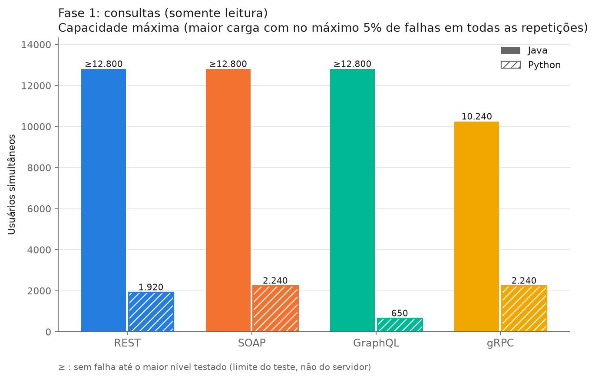
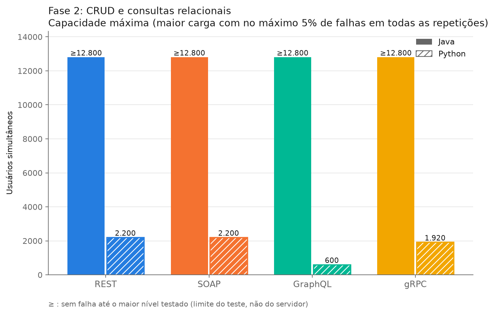
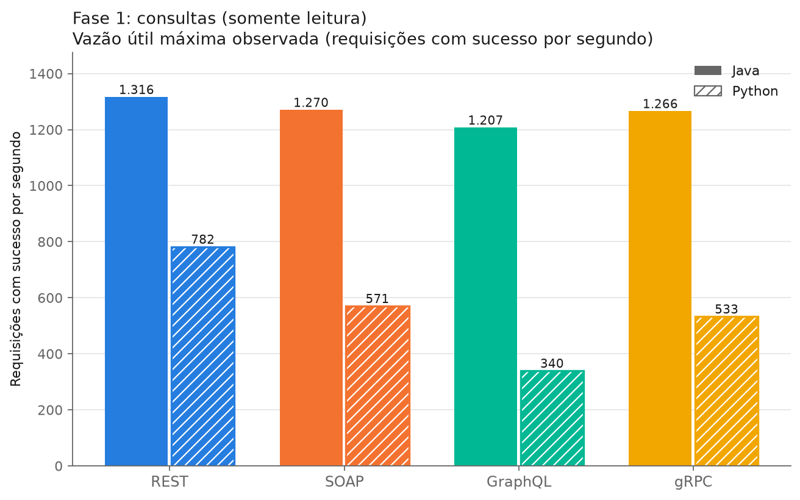
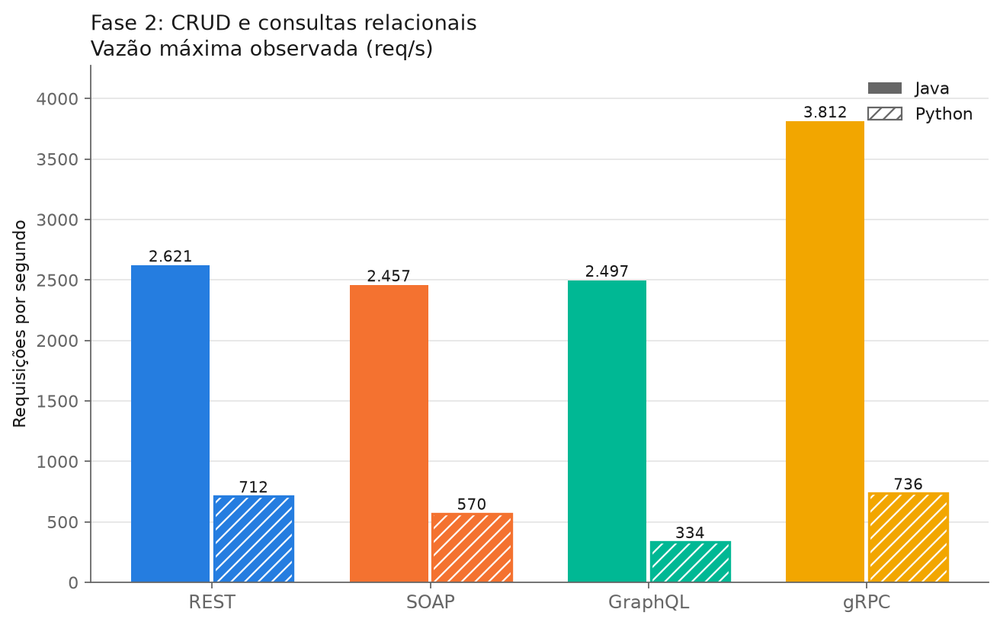

# Trabalho 6: streaming-apis

Comparação de quatro tecnologias de invocação de serviços remotos (SOAP, REST, GraphQL e gRPC), cada uma implementada em Java e em Python, para um mesmo serviço de streaming de música. As 8 versões usam o mesmo Postgres, o mesmo Docker Compose e os mesmos limites de CPU e memória, e foram submetidas a testes de carga com Locust para descobrir a capacidade máxima de cada uma.

## Como foi feito

**O serviço.** Três recursos: usuários, músicas e playlists. Cada API oferece, para cada recurso, listar (com paginação e busca por nome), obter, criar, atualizar e remover, e mais três consultas relacionais: playlists de um usuário, músicas de uma playlist e playlists que contêm uma música. As regras são iguais em todas as versões: 404 quando não existe, 400 para dados inválidos e 409 ao remover uma música que está em alguma playlist.

**Implementações.** Cada linguagem tem um núcleo (`java/core`, `python/core`) com as regras e o acesso ao banco, compartilhado pelos quatro adaptadores de protocolo. Java: Spring Boot 3.3.5 e Java 21. Python: 3.12, FastAPI, Strawberry e grpcio. O SOAP é implementado à mão nas duas linguagens.

**Banco.** Postgres 16, populado de forma determinística (semente 42): 5.000 usuários, 20.000 músicas, 15.000 playlists e 598.223 vínculos entre playlists e músicas. Os registros são grandes de propósito (texto longo, listas e JSON), para que a serialização pese de verdade. Antes de cada versão, o banco é recriado a partir de um modelo.

**Ambiente igual para todas.** Mesmo Compose e mesmos limites: API com 2 CPUs e 1 GB, banco com 2 CPUs e 2 GB, uma versão por vez. O total de conexões com o banco é o mesmo: 32 no Java e 2 processos × 16 no Python.

**Teste de carga.**
- O Locust usa laço fechado: cada usuário virtual faz uma requisição e espera 0,5 s. Cinco segundos de aquecimento são descartados e há 15 s de medição por nível (modo rápido).
- Uma requisição é falha se der erro de protocolo ou demorar mais de 5 s.
- A capacidade máxima é o maior número de usuários simultâneos com no máximo 5% de falhas em todas as 3 repetições. Uma sonda dobra a carga (50, 100, 200, ...) até a primeira falha acima de 5% e refina por bisseção. Os níveis reais (40%, 60%, 80% e 100% do último nível bom, mais o primeiro ruim) são medidos 3 vezes cada.
- Fase 1 (consultas): só leitura. Fase 2 (CRUD): ciclo de 13 passos por usuário virtual (criar, obter, atualizar, consultar relações e remover só o que criou).
- Os testes do Java usaram 4 processos do Locust, para o gerador não limitar o servidor.

**Estrutura do repositório:**

```
docker-compose.yml     banco, as 8 APIs (perfis), seed e Locust
.env                   limites de CPU e memória (API, banco e Locust)
proto/                 contrato gRPC (streaming.proto)
db/                    schema.sql e seed.py
java/                  core (regras), rest, soap, graphql, grpc
python/                core (regras), rest, soap, gql, rpc
loadtest/              scripts do Locust, orquestrador.py, manual.py e verificar.py
scripts/               automação em PowerShell
analysis/              resultados (JSON), graficos.py e gráficos (PNG)
docs/                  analise-critica.md
```

## Como replicar

Requisitos: Windows com PowerShell, Docker Desktop (WSL2) com pelo menos 8 CPUs e 8 GB de memória, Git e Python 3. Para os gráficos: `pip install matplotlib`. Java e Maven não precisam estar instalados, porque tudo compila dentro do Docker. Todos os comandos rodam na raiz do projeto.

**1. Conferir o ambiente:**

```powershell
.\scripts\verificar-ambiente.ps1
```

**2. Criar o banco** (modelo `streaming_base` e banco `streaming`):

```powershell
.\scripts\banco-semear.ps1
```

**3. Subir uma versão** (uma de cada vez, na porta 8080). Perfis: `java-rest`, `java-soap`, `java-graphql`, `java-grpc`, `python-rest`, `python-soap`, `python-graphql`, `python-grpc`.

```powershell
.\scripts\api-subir.ps1 -Perfil java-rest
.\scripts\api-parar.ps1 -Perfil java-rest
```

**4. Verificar que as 8 versões se comportam do mesmo jeito.** Executa a mesma sequência de operações (listar, buscar, obter, criar, atualizar, remover e consultas relacionadas) nos 3 recursos de cada versão:

```powershell
.\scripts\verificar-tudo.ps1
```

**5. Testes de capacidade.** Tudo de uma vez (consultas, depois CRUD, depois os gráficos):

```powershell
.\scripts\rodar-tudo.ps1 -Modo rapido
```

Use `-Modo completo` para medições de 30 s por nível e `-Retomar` para continuar de onde parou. Para versões específicas:

```powershell
python -u loadtest\orquestrador.py --versoes java-rest java-grpc --fase consultas --modo rapido --processos 4
```

Parâmetros: `--fase consultas|crud`, `--modo rapido|completo`, `--maximo N` (maior número de usuários da sonda), `--processos N` (processos do Locust), `--niveis ...` (mede níveis específicos para refinar um resultado) e `--refazer`.

**6. Gráficos e resumo:**

```powershell
python analysis\graficos.py
```

Os resultados brutos ficam em `analysis/results/<fase>/<versao>.json` e os gráficos em `analysis/graficos/`.

**Modo manual.** Para explorar qualquer versão à mão, escolhendo a API e a linguagem (listar, buscar por nome, obter, criar, atualizar, remover e consultas relacionadas, com a requisição e a resposta do protocolo à vista):

```powershell
.\scripts\manual.ps1
```

O banco é recriado a cada execução. Use `-Versao java-grpc` para ir direto a uma versão, `-SemReset` para manter os dados e `-Manter` para deixar o serviço no ar ao sair. Com uma versão no ar, também dá para usar ferramentas externas: REST em `http://localhost:8080/usuarios`, SOAP em `http://localhost:8080/soap` (WSDL por GET), GraphQL em `http://localhost:8080/graphql` (Java também em `/graphiql`) e gRPC na porta 8080, sem TLS e com reflexão (`grpcurl -plaintext localhost:8080 list`).

## Resultados

Capacidade máxima: maior número de usuários simultâneos com no máximo 5% de falhas em todas as 3 repetições.

| API | Java consultas | Python consultas | Java CRUD | Python CRUD |
|---|---|---|---|---|
| REST | 6.400 | 1.920 | 10.240 | 2.200 |
| SOAP | 6.400 | 2.240 | 9.600 | 2.200 |
| GraphQL | 5.120 | 650 | 10.240 | 600 |
| gRPC | 8.000 | 2.240 | ≥25.600 | 1.920 |

Vazão útil máxima (requisições com sucesso por segundo):

| API | Java consultas | Python consultas | Java CRUD | Python CRUD |
|---|---|---|---|---|
| REST | 1.316 | 782 | 2.621 | 712 |
| SOAP | 1.270 | 571 | 2.436 | 570 |
| GraphQL | 1.207 | 340 | 2.497 | 334 |
| gRPC | 1.266 | 533 | 3.812 | 626 |

O "≥25.600" do gRPC em Java no CRUD é o maior nível testado, sem falhas: o gerador de carga saturou antes do servidor. Os valores têm resolução de cerca de ±10%, por causa do modo rápido. A análise completa, com as limitações, está em [`docs/analise-critica.md`](docs/analise-critica.md), e os gráficos estão em [`analysis/graficos/`](analysis/graficos/).

### Gráficos

Capacidade máxima por API e linguagem:





Vazão útil máxima (requisições com sucesso por segundo):





As curvas de carga contra falhas e vazão (com os níveis que falharam marcados com X e a linha de 5%) e a comparação entre linguagens estão em [`analysis/graficos/`](analysis/graficos/): `curvas_*` e `linguagens_*`.
